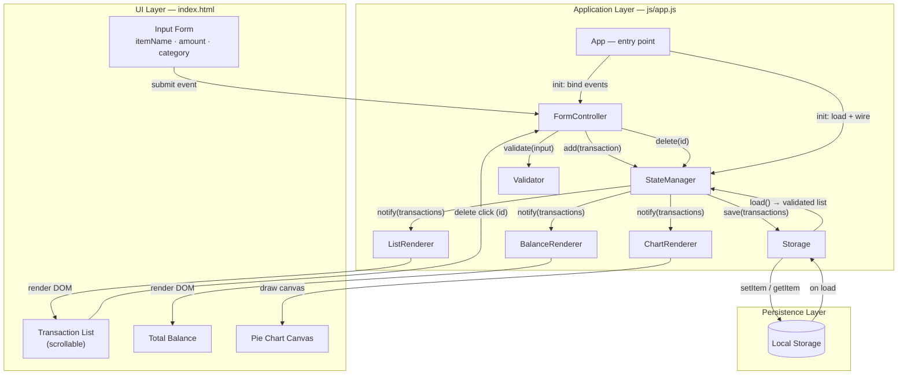

# Design Document: Expense_Budget_Visualizer

## Overview

The Expense_Budget_Visualizer is a client-side web application that lets users record expense transactions, review them in a scrollable list, monitor a running total balance, and visualize spending distribution by category through a pie chart. All data is stored in the browser via the Local Storage API. The application uses no backend server and no external JavaScript libraries or frameworks.

The design follows a lightweight observer (publish-subscribe) pattern within a single Vanilla JavaScript file. A centralized state manager holds the transaction array and notifies registered renderers whenever transactions change. Each renderer (list, balance, chart) is responsible for updating its own DOM region. A storage module abstracts Local Storage access with graceful degradation to in-memory storage when persistence is unavailable.

### Key Design Decisions

| Decision | Rationale |
|----------|-----------|
| **Observer pattern for state synchronization** | Decouples state from rendering. When a transaction is added or deleted, the state manager notifies all renderers, guaranteeing the list, balance, and chart stay in sync without manual coordination. |
| **Pure validation and calculation functions** | Validation, balance summation, and chart angle/proportion calculations are extracted as pure functions separate from DOM logic. This makes them independently testable with property-based tests. |
| **Canvas-based pie chart (no libraries)** | The Canvas 2D API is natively supported in all target browsers and satisfies the constraint of no external JS libraries. Slices are drawn as filled arcs with angles proportional to category totals. |
| **Storage abstraction with fallback** | Local Storage access is wrapped so that availability is checked once at startup. If unavailable (private browsing, quota errors, disabled), the app falls back to in-memory storage for the session and displays an error message. |
| **Chronological storage, reverse display** | Transactions are stored in insertion order (append on add), which keeps the storage round-trip clean. The list renders newest-first to satisfy Requirement 2.3. |
| **DOM API for list rendering (createElement)** | Using `createElement`/`textContent` instead of `innerHTML` avoids HTML injection from user-entered item names and is equally performant for reasonable transaction counts. |
| **Full re-render on each change** | Simpler than incremental DOM diffing. With typical personal-finance transaction volumes (tens to hundreds of entries), full re-render of list, balance, and chart completes well within the 200ms budget. |
| **Field and display constraints enforced at the edge** | The Item_Name input is capped at 100 characters with a `maxlength` attribute (Requirement 1.1), and the Total_Balance is always rendered to exactly 2 decimal places through a pure `formatBalance` helper (Requirement 4.1). Keeping these constraints in dedicated helpers makes display behavior predictable and testable. |

## Architecture

The application has three layers:

1. **UI Layer** (`index.html`): Static HTML structure defining four visually distinguishable, non-overlapping regions — Total Balance, Input Form, Transaction List, and Pie Chart — with no overlap between any pair of regions and each pair of adjacent regions separated by a visible gap of at least 16 pixels or a visible border (Requirement 10.1).
2. **Application Layer** (`js/app.js`): A single JavaScript file containing all logic, organized into clearly delimited modules using object-literal patterns.
3. **Persistence Layer**: Browser Local Storage, accessed through the Storage module.



### Data Flow

**Adding a transaction:**
1. User fills the Input Form and clicks submit (or presses Enter).
2. `FormController` reads the field values and calls `Validator.validate(itemName, amount, category)`.
3. If validation fails, `FormController` displays the `Validation_Message` in the form region and returns — no transaction is added.
4. If validation passes, `FormController` constructs a `Transaction` object (generating a unique `id` and a `createdAt` timestamp) and calls `StateManager.add(transaction)`.
5. `StateManager` appends the transaction to its internal array, calls `Storage.save()` to persist, and notifies all subscribed renderers with the updated list.
6. `ListRenderer`, `BalanceRenderer`, and `ChartRenderer` each re-render their respective regions.
7. `FormController` clears the input fields.

**Deleting a transaction:**
1. User clicks the delete control on a transaction row.
2. The delete button's click handler (delegated by `ListRenderer`) reads the transaction `id` from the row's data attribute and calls `StateManager.delete(id)`.
3. `StateManager` removes the matching transaction, calls `Storage.save()`, and notifies all renderers.
4. All renderers re-render to reflect the updated state.

**Application load:**
1. On `DOMContentLoaded`, the `App` entry point runs.
2. It checks `Storage.isAvailable()`. If Local Storage is unavailable, it displays an error message and configures the app to use in-memory-only storage.
3. It calls `Storage.load()` to retrieve persisted transactions. The storage module validates each entry; corrupted or invalid entries are excluded.
4. `StateManager` is initialized with the loaded (and validated) transaction list.
5. All renderers render the initial state.

## Components and Interfaces

### StateManager

Holds the authoritative transaction array and coordinates updates. Uses a simple observer pattern: renderers subscribe and are called with the full transaction list on every mutation.

```
StateManager = {
  transactions: Transaction[],      // chronological insertion order
  listeners: Function[],             // subscribed renderers

  init(loaded: Transaction[]): void  // initialize with persisted data
  add(transaction: Transaction): void
  delete(id: string): void
  getAll(): Transaction[]             // returns a copy (newest-first for display)
  subscribe(listener: (transactions: Transaction[]) => void): void
  notify(): void                      // calls all listeners with current list
}
```

### Storage

Abstracts Local Storage access. Detects availability at startup and degrades to in-memory storage if Local Storage is not usable. All read operations validate each transaction and silently drop invalid entries.

```
Storage = {
  KEY: "expense_budget_visualizer_transactions",
  available: boolean,
  memoryFallback: Transaction[],    // used only when Local Storage is unavailable

  isAvailable(): boolean             // try/catch probe at startup
  save(transactions: Transaction[]): void   // JSON.stringify, localStorage.setItem
  load(): Transaction[]               // getItem, JSON.parse, validate each, return valid only
}
```

### Validator

Pure functions with no side effects. Each function validates one field and returns a result object. The composite `validate` function checks all fields and returns the first error encountered (or a success result).

```
Validator = {
  validateItemName(value: string): { valid: boolean, message: string }
  validateAmount(value: string):   { valid: boolean, message: string }
  validateCategory(value: string): { valid: boolean, message: string }
  validate(itemName: string, amount: string, category: string):
    { valid: true, transaction: { itemName, amount, category } }
    | { valid: false, field: string, message: string }
}
```

Validation rules:
- **Item_Name**: must be non-empty after trimming whitespace. The corresponding input field enforces a maximum of 100 characters through a `maxlength="100"` attribute (Requirement 1.1), so a submission never carries a value longer than 100 characters; validation therefore only needs to check non-emptiness.
- **Amount**: must parse as a finite number, and that number must be positive and within the range [0.01, 999,999,999.99].
- **Category**: must be one of `"Food"`, `"Transport"`, `"Fun"`.

### ListRenderer

Renders the scrollable transaction list. Displays newest-first. Shows an empty-state message when there are no transactions. Uses event delegation on the container for delete-button clicks.

```
ListRenderer = {
  container: HTMLElement,
  render(transactions: Transaction[]): void   // clears and rebuilds DOM
  onDelete: (id: string) => void                // callback wired to StateManager.delete
}
```

### BalanceRenderer

Calculates and renders the total balance. The calculation is a pure helper (`sumAmounts`) that is also used by the chart renderer, ensuring a single source of truth for summation. The displayed value is always formatted to exactly 2 decimal places (Requirement 4.1) through the pure `formatBalance` helper.

```
BalanceRenderer = {
  element: HTMLElement,
  render(transactions: Transaction[]): void   // displays formatBalance(sumAmounts(transactions))
}

// Pure helpers (also used by ChartRenderer)
sumAmounts(transactions: Transaction[]): number
formatBalance(amount: number): string          // formats to exactly 2 decimal places
```

### ChartRenderer

Draws the pie chart on a `<canvas>` element. Computes category totals and slice angles as pure functions, then draws filled arcs on the canvas context. Each slice is labeled with its category name. Shows an empty-state message when there are no transactions.

```
ChartRenderer = {
  canvas: HTMLCanvasElement,
  ctx: CanvasRenderingContext2D,
  render(transactions: Transaction[]): void   // clears canvas, draws slices + labels
}

// Pure helpers (extracted for testability)
calculateCategoryTotals(transactions: Transaction[]): CategoryTotals
calculateSliceAngles(totals: CategoryTotals): { category: string, startAngle: number, endAngle: number }[]
```

Drawing logic:
- The canvas is cleared at the start of each render.
- Slices are drawn clockwise starting from the top (angle = -π/2).
- Only categories that have at least one assigned transaction produce a slice; categories with no assigned transactions (zero total) are skipped and no segment is drawn (Requirement 5.1).
- Each category's slice angle = `(categoryTotal / grandTotal) × 2π`.
- Each non-empty slice is labeled with its category name, positioned at the angular midpoint of the slice at roughly 65% of the radius.
- The empty state (no transactions or grand total of zero) displays a centered message on the canvas indicating no spending data is available.

### FormController

Handles form submission, invokes validation, and coordinates with `StateManager`. Clears the form on successful submission. Displays validation messages in a dedicated message element within the form region.

```
FormController = {
  form: HTMLFormElement,
  itemNameInput: HTMLInputElement,   // maxlength="100" (Requirement 1.1)
  amountInput: HTMLInputElement,
  categorySelect: HTMLSelectElement,
  messageElement: HTMLElement,
  stateManager: StateManager,

  handleSubmit(event: Event): void
  clearForm(): void
  showMessage(field: string, message: string): void
  clearMessage(): void
}
```

The `itemNameInput` carries a `maxlength="100"` attribute so the field cannot accept more than 100 characters, satisfying Requirement 1.1 at the input edge.

### App (entry point)

Initializes all modules on `DOMContentLoaded`. Checks storage availability, loads persisted transactions, wires event handlers, and triggers the initial render.

```
App = {
  init(): void   // runs on DOMContentLoaded
}
```

## Data Models

### Transaction

The core data entity. Stored in chronological insertion order in both the state manager and Local Storage.

```typescript
interface Transaction {
  id: string;        // Unique identifier. Generated via crypto.randomUUID()
                     // when available, with a Date.now() + Math.random()
                     // fallback for older browsers.
  itemName: string;  // Non-empty after trimming, up to 100 characters
                     // (enforced by the form field's maxlength attribute,
                     // Requirement 1.1). User-entered label.
  amount: number;    // Positive finite number in [0.01, 999999999.99].
                     // Stored as a number; the Total_Balance is rendered to
                     // exactly 2 decimal places (Requirement 4.1).
  category: string;  // One of: "Food", "Transport", "Fun".
  createdAt: number; // Unix timestamp (Date.now()) at creation time.
                     // Used for stable newest-first ordering.
}
```

### ValidationResult

Returned by the `Validator` composite function. On success it carries the validated (trimmed, parsed) values ready for `Transaction` construction. On failure it identifies the offending field and includes a human-readable message.

```typescript
type ValidationResult =
  | { valid: true;  transaction: { itemName: string; amount: number; category: string } }
  | { valid: false; field: string; message: string };
```

### CategoryTotals

Used by the `ChartRenderer` to compute slice proportions. Each key maps to the sum of all transaction amounts in that category.

```typescript
interface CategoryTotals {
  Food: number;
  Transport: number;
  Fun: number;
}
```

### Local Storage Format

Transactions are persisted as a JSON-encoded array of `Transaction` objects under a single key:

```
Key:   "expense_budget_visualizer_transactions"
Value: [{"id":"...","itemName":"...","amount":12.50,"category":"Food","createdAt":...}, ...]
```

When loading, each array element is validated: it must be an object with `id` (string), `itemName` (non-empty string), `amount` (finite number in valid range), and `category` (one of the three allowed values). Entries failing validation are excluded. If the entire stored value fails `JSON.parse` or is not an array, an empty list is returned.

## Correctness Properties


*A property is a characteristic or behavior that should hold true across all valid executions of a system — essentially, a formal statement about what the system should do. Properties serve as the bridge between human-readable specifications and machine-verifiable correctness guarantees.*


### Property 1: Validation rejects incomplete or whitespace-only inputs

*For any* combination of field values where at least one field (Item_Name, Amount, or Category) is empty or contains only whitespace, the Validator SHALL return a result with `valid === false` identifying the offending field, and no transaction SHALL be added.

**Validates: Requirements 1.3, 1.4**

### Property 2: Amount range validation

*For any* amount string, the Validator SHALL accept it if and only if it parses to a finite number within the range [0.01, 999,999,999.99]. Any amount outside this range, non-numeric, zero, or negative SHALL be rejected.

**Validates: Requirements 1.5**

### Property 3: Adding a valid transaction grows the list and places it at the top

*For any* initial state and any valid transaction, after adding it to the state, the Transaction_List SHALL contain exactly one more entry than before, and the newly added transaction SHALL appear as the first entry in the displayed list.

**Validates: Requirements 1.6, 2.3**

### Property 4: Successful submission clears the form fields

*For any* non-empty form state and any valid transaction submission, after the transaction is added, the Item_Name, Amount, and Category fields SHALL all be empty.

**Validates: Requirements 1.6**

### Property 5: Rendered rows display required fields and a delete control

*For any* set of transactions, each rendered row in the Transaction_List SHALL contain the transaction's Item_Name, formatted Amount, and Category, and SHALL include a delete control.

**Validates: Requirements 2.2, 3.1**

### Property 6: Delete removes exactly the target and preserves all others

*For any* state and any existing transaction id, after deleting that id, the deleted transaction SHALL no longer appear in the list, and all other transactions SHALL remain unchanged in both count and content.

**Validates: Requirements 2.4, 3.2, 3.3**

### Property 7: Total balance equals the sum of all amounts and is formatted to two decimal places

*For any* set of transactions, the Total_Balance SHALL equal the sum of all transaction Amounts and SHALL be displayed as a string with exactly two decimal places. This SHALL hold after adding a transaction and after deleting a transaction.

**Validates: Requirements 4.1, 4.2, 4.3**

### Property 8: Pie chart segments are proportional, limited to active categories, and labeled

*For any* set of transactions with a non-zero grand total, the Pie_Chart SHALL contain exactly one segment for each Category that has at least one assigned transaction and no segment for any Category with no assigned transactions. Each segment's angle SHALL equal `(categoryTotal / grandTotal) × 2π`, and each segment SHALL be labeled with its Category name.

**Validates: Requirements 5.1, 5.5**

### Property 9: Storage round-trip preserves transaction data

*For any* set of valid transactions, storing the set to Local_Storage and then loading it SHALL produce a set with the same count and matching Item_Name, Amount, and Category for each transaction.

**Validates: Requirements 6.4**

### Property 10: Loading excludes invalid stored data

*For any* stored data containing corrupted or invalid entries (malformed JSON, wrong field types, out-of-range amounts, or invalid categories), loading SHALL produce only valid transactions and SHALL exclude all invalid entries.

**Validates: Requirements 6.6**

## Error Handling

### Local Storage Unavailability (Requirement 6.5)

Detected at startup by a try/catch probe that writes and removes a test key. If Local Storage is unavailable (private browsing mode, disabled by policy, etc.):

- Display an error message in a non-intrusive banner at the top of the interface.
- Set an `available` flag to `false`; all subsequent save/load operations route to an in-memory array instead of `localStorage`.
- The application continues to function normally for the current session; data is simply not persisted across reloads.

### Local Storage Quota Exceeded (Requirement 6.7)

When `localStorage.setItem` throws `QuotaExceededError` during a save operation:

- Catch the error and display a message informing the user that data could not be saved.
- The in-memory state remains correct and consistent — only persistence is affected.
- The user can continue adding and deleting transactions for the current session.

### Corrupted or Invalid Stored Data (Requirement 6.6)

When loading transactions from Local Storage:

- Wrap `JSON.parse` in a try/catch. If parsing fails entirely (malformed JSON), return an empty list.
- After parsing, validate each array element individually. An entry is valid only if it is an object with:
  - `id`: a non-empty string
  - `itemName`: a non-empty string (after trimming)
  - `amount`: a finite number within [0.01, 999,999,999.99]
  - `category`: one of `"Food"`, `"Transport"`, `"Fun"`
- Invalid entries are silently excluded; valid entries are loaded. No error is shown to the user for individual invalid entries — the app simply starts with whatever valid data is available.

### Validation Errors (Requirements 1.4, 1.5)

When form submission fails validation:

- Display a `Validation_Message` in a dedicated message element within the form region, indicating which field is invalid and a human-readable reason.
- The message is cleared on the next submission attempt or when the user edits the offending field.
- No transaction is added on validation failure; the form retains its current input values so the user can correct them.

### Canvas Rendering Errors

- If the canvas 2D context cannot be obtained (`getContext('2d')` returns null), display the chart region's empty-state message instead of the chart.
- Canvas drawing operations do not throw under normal conditions, but the render function is structured to degrade gracefully — if drawing fails, the previous canvas state remains and the application continues.

## Testing Strategy

### Test Framework and Tools

| Tool | Purpose |
|------|---------|
| **Vitest** | Test runner — fast, works with Vanilla JS, supports jsdom for DOM testing |
| **jsdom** | Provides `document`, `localStorage`, and canvas elements in a Node environment |
| **fast-check** | Property-based testing library for all PBT tests |
| **Playwright** | Cross-browser end-to-end tests for Requirements 8.1 and 8.2 |

### Dual Testing Approach

**Property-based tests** verify universal properties across many generated inputs. **Unit/integration tests** verify specific examples, edge cases, and infrastructure wiring. Both are complementary and necessary for comprehensive coverage.

### Property-Based Tests (PBT)

Each property test uses fast-check with a minimum of 100 iterations. Each test is tagged with a comment referencing the design property using the format: `// Feature: expense-budget-visualizer, Property N: [property text]`

| Test | Property | Generator | What Varies | What Is Verified |
|------|----------|-----------|-------------|------------------|
| PBT-1 | Property 1 | Random field combos with ≥1 empty/whitespace field | Which field is empty, whitespace content | Validation fails and identifies the offending field |
| PBT-2 | Property 2 | Random amount strings (valid, out-of-range, non-numeric, negative, zero) | Numeric value, string format | Accept iff in [0.01, 999999999.99] |
| PBT-3 | Property 3 | Random initial states + random valid transactions | State size, transaction content | List grows by 1, new entry is first |
| PBT-4 | Property 4 | Random non-empty form states + valid submissions | Form field values | All fields cleared after submit |
| PBT-5 | Property 5 | Random transaction sets | Transaction count, content, categories | Each row has name, amount, category, delete control |
| PBT-6 | Property 6 | Random states + random existing ids | State size, which id is deleted | Target removed, all others unchanged |
| PBT-7 | Property 7 | Random states + add/delete operations | Transaction amounts, state size | Balance === sum of all amounts and displayed with exactly 2 decimal places |
| PBT-8 | Property 8 | Random transaction sets | Category distribution, amounts | One segment per active category, none for empty categories, angles proportional, segments labeled |
| PBT-9 | Property 9 | Random valid transaction sets | Transaction count, content | Save then load produces identical set |
| PBT-10 | Property 10 | Random data with invalid entries mixed in | Type of corruption, ratio of valid/invalid | Only valid transactions loaded |

### Unit Tests (Example-Based)

Focused on specific scenarios, edge cases, and integration points — not duplicating what PBT already covers:

- **Form structure**: verify form contains Item_Name, Amount, Category fields with correct input types and that the Item_Name input has `maxlength="100"` (1.1)
- **Category options**: verify the Category field offers exactly Food, Transport, and Fun (1.2)
- **List scrollability**: verify list container has scrollable CSS (`overflow-y: auto` or `scroll`) (2.1)
- **Empty-state messages**: verify list shows "no transactions" message and chart shows "no spending data" message when empty (2.5, 5.4)
- **Delete without confirmation**: verify activating a delete control removes the row with no confirmation prompt (3.2)
- **Chart re-render on add/delete**: verify chart canvas is cleared and redrawn after a state change (5.2, 5.3)
- **Storage unavailable fallback**: mock unavailable localStorage, verify error message and in-memory operation (6.5)
- **Storage quota exceeded**: mock `QuotaExceededError` on `setItem`, verify a message is shown and the transaction is retained in memory (6.7)
- **Layout separation**: verify four region bounding rects do not overlap and adjacent regions are separated by at least a 16px gap or a visible border (10.1)
- **Performance benchmark**: add and delete with up to 1,000 transactions, measure update time for the list, balance, and chart, and assert all three update within 200ms (9.1)

### Smoke / Inspection Tests

- No external JS libraries loaded in `index.html` — assert no `<script src="https://...">` or framework tags (7.1)
- No backend calls in source — assert no `fetch`, `XMLHttpRequest`, or `WebSocket` to external endpoints (7.2)
- Exactly one CSS file in `css/` directory (7.3)
- Exactly one JS file in `js/` directory (7.4)
- Exactly one HTML file that references the single CSS file and the single JS file (7.5)
- Computed contrast ratio ≥ 4.5:1 for text elements (10.2) — note: full WCAG validation requires manual testing with assistive technologies
- Computed font-size ≥ 16px for all text elements (10.3)

### Integration Tests

- **Persistence round-trip end-to-end**: seed localStorage with known transactions, load the app, verify list, balance, and chart are populated (6.3)
- **Save on mutation**: mock localStorage, add/delete transactions, verify `setItem` called with correct serialized data (6.1, 6.2)
- **Cross-browser end-to-end**: run the full workflow (add, view list, check balance, view chart, delete) in the two most recent major versions of Google Chrome, Mozilla Firefox, Microsoft Edge, and Apple Safari via Playwright (8.1)
- **Session persistence**: close and reopen each supported browser, verify stored Transactions are retrieved from Local_Storage and displayed in the Transaction_List, Total_Balance, and Pie_Chart (8.2)

### Custom fast-check Arbitraries

To support the property tests, the following custom generators are defined:

- **`validTransaction`**: generates a `Transaction` with a random non-empty `itemName` (up to 100 characters), an `amount` in [0.01, 999999999.99], and a `category` randomly selected from Food/Transport/Fun.
- **`invalidAmount`**: generates strings that should be rejected — non-numeric strings, negative numbers, zero, values below 0.01, values above 999999999.99, and `NaN`-producing strings.
- **`whitespaceString`**: generates strings composed entirely of random whitespace characters (spaces, tabs, newlines) of varying length.
- **`transactionSet`**: generates arrays of `validTransaction` entries with random length (0–50).
- **`corruptedStorageEntry`**: generates invalid transaction-like objects with wrong field types, missing fields, out-of-range amounts, or invalid categories.

### Test File Organization

```
test/
├── properties/              # Property-based tests (fast-check, ≥100 iterations each)
│   ├── validation.test.js   # Properties 1, 2
│   ├── state.test.js        # Properties 3, 6
│   ├── form.test.js         # Property 4
│   ├── render.test.js       # Property 5
│   ├── balance.test.js      # Property 7
│   ├── chart.test.js        # Property 8
│   └── storage.test.js      # Properties 9, 10
├── unit/                    # Example-based unit tests
│   ├── form.test.js
│   ├── list-renderer.test.js
│   ├── chart-renderer.test.js
│   ├── empty-states.test.js
│   ├── storage-fallback.test.js
│   └── quota-error.test.js
├── integration/             # Integration tests
│   ├── persistence.test.js
│   └── browser.test.js      # Playwright cross-browser (8.1, 8.2)
└── smoke/                   # Inspection/smoke tests
    ├── structure.test.js     # 7.1–7.5
    ├── accessibility.test.js # 10.2, 10.3
    └── performance.test.js   # 9.1
```
